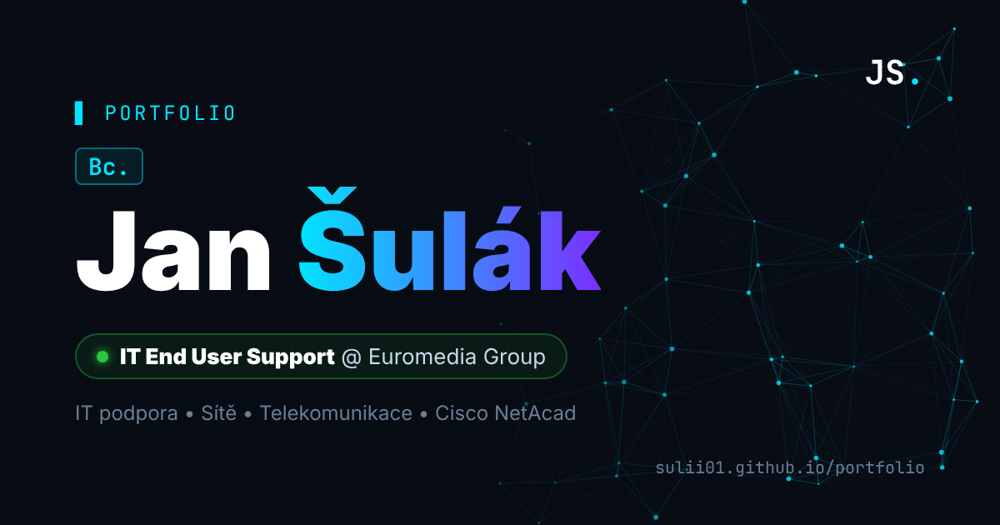

# Bc. Jan Šulák – Portfolio

Osobní portfolio – IT End User Support, sítě a telekomunikace.

🌐 **Web:** https://sulii01.github.io/portfolio/ ([English version](https://sulii01.github.io/portfolio/?lang=en))



## Obsah webu

- **O mně** a aktuální pozice (IT End User Support, Euromedia Group)
- **Pracovní zkušenosti** – časová osa
- **Projekty** – ISP-LAB (GNS3 + MikroTik), Nextcloud na třech virtuálech, RFID autentizační server, Zabbix monitoring a další
- **Vzdělání** – VŠB-TUO (Bc. Telekomunikační technika, Ing. Komunikační a informační technologie)
- **Dovednosti** – IT podpora, sítě, servery a virtualizace, programování, jazyky
- **Certifikáty** a odznaky Cisco Networking Academy (Credly)
- **Kontakt**, CV ke stažení (CZ / EN) a odkazy na LinkedIn, GitHub a Credly

## Technologie

Čisté HTML, CSS a JavaScript bez frameworků, nasazené přes GitHub Pages.

- dvojjazyčný obsah CZ / EN (anglické texty v atributech `data-en`, volba se pamatuje)
- animované síťové pozadí (canvas), psací terminál, responzivní layout

## Struktura

```
index.html      – obsah stránky (české texty + anglické v data-en)
css/style.css   – vzhled
js/main.js      – animace, přepínání jazyka, odkazy (konfigurace LINKS)
certs/          – PDF certifikáty
cv/             – CV ke stažení (CZ a EN)
og-image.png    – náhled při sdílení odkazu
```

## Úpravy

- **Odkazy a CV:** objekt `LINKS` na začátku `js/main.js`. Prázdná hodnota znamená, že se tlačítko nebo ikona nezobrazí.
- **Po změně `css/style.css` nebo `js/main.js`** zvyšte v `index.html` číslo za `?v=`, aby prohlížeče načetly novou verzi.
